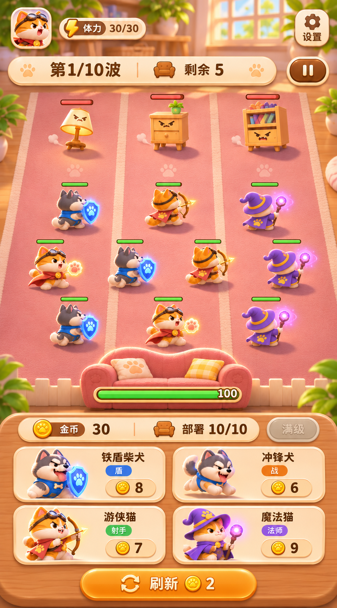

# 局内 UI 效果图 v2

状态：视觉方案，尚未切图或接入游戏。

## 比例与容量

- 顶部背景与状态栏约占全屏 19%。
- 三路战斗区约占全屏 57%，包括敌方入口、角色部署和守护物。
- 底部商店约占全屏 24%，保留饼干、席位、四张角色卡与刷新控件。
- 用 10 名同时部署的角色检查空间：按前排 3 名、中排 4 名、后排 3 名排布，角色使用已有猫狗类型的重复单位。
- 背景可延伸至全屏；可点击控件与部署命中区仍需依照设备安全区定位。

## 实现前核对

- 效果图仅表达比例和风格，不把图上的波次、敌人数量或角色位置当成玩法规则。
- 切图前按真实布局计算角色最小间距、单位碰撞体积及纵横屏安全区；操作中需留出拖放预览和特效空间。
- 商店卡牌应以独立透明素材绘制，避免缩放时带入背景边缘。
