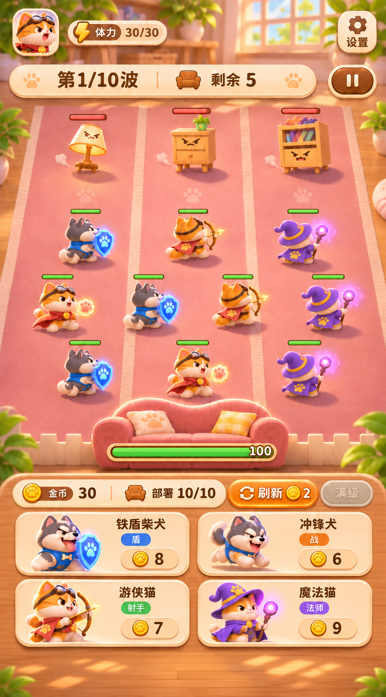

# 局内 UI 效果图 v3

状态：视觉方案，尚未切图或接入游戏。

沿用 v2 的三路战场与 10 名角色容量。刷新按钮从屏幕底端移至商店顶部操作栏，与饼干、部署席位及满级状态同层。四张角色卡位于操作栏下方，底部保留仅供展示的木地板背景。

实现时以设备实际安全区计算刷新按钮、卡牌及其他控件的绘制位置和触摸区域；底部背景可以铺满屏幕，但不得有可点击区域。若卡牌下沿落入底部安全区，须整体上移商店控件或缩小卡牌，不能只移动点击命中框。
