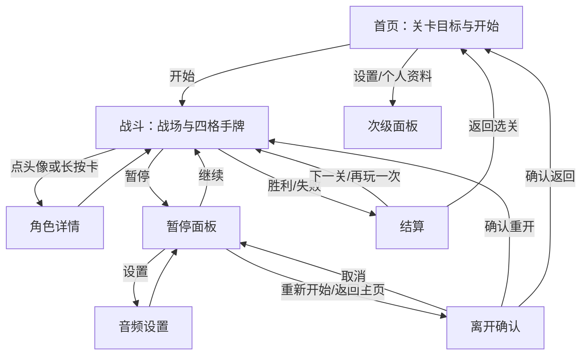

# 单人测试 Demo：界面与交互白盒审查 v1

状态：**提案，待用户审核**。依据为当前 `codex/in-game-art-integration` 分支的 `gameplay/render/hud.js`、`gameplay/ui.js`、`gameplay/input.js`、`gameplay/game.js` 和项目决策记录。本文不改变已实现机制，也不表示 `main` 已接受这些取舍。[可点击低保真原型](index.html)仅供讨论结构与流程，使用浏览器 DOM 是**设计工具**，不进入快手小游戏 `package/`；正式运行时仍需 WebGL 1.0 自绘。

首页选关的两部分细化见[关卡展示与切换交互 v1](首页关卡展示与切换-v1.md)：已在白盒中加入关卡名、锁定原因、重玩文案、边界箭头及手机横滑跟手示意，仍待审核。

## 目标与判定原则

- 当前交付目标是用户**单人测试 Demo**；正式产品希望连续游玩 30–60 分钟，但不把这一时长当作 Demo 单局通过条件。
- 体验排序：先让玩家觉得「我操作得真爽」，再因操作体验想收集猫狗。每个常驻入口应服务“进入战斗、操作、读懂反馈、决定下一局”。
- 不把参考游戏的棋盘、活动、商城或付费入口迁入本项目。首页美术可铺满全屏；所有可点击区仍处于动态交互安全区。
- **现状**指代码行为，**建议**指本轮待审取舍。确认后才改游戏与制作正式美术。

## 页面与入口盘点

| 位置 / 功能 | 当前实现 | 建议 | 原因与注意 |
|---|---|---|---|
| 首页关卡卡、左右选关、开始 | 10 关顺序解锁，首页保留旧 Figma 大卡视觉并动态盖关卡标题 | **保留并作为首页主轴** | 直接回答“去哪一关、守护什么、能否开战”；锁定态需要说明前置关卡 |
| 首页头像、名片、昵称、9 头像 | 可点击，资料本地保存 | **收进次级入口**；保留功能但不与开始按钮同权重 | 单人 Demo 的身份定制不是核心验证；头像不是当前玩法中的角色收集 |
| 首页体力 30/30 | 仅展示和弹窗，未接入消耗/恢复闭环 | **暂不作为可交互主入口**，待体力规则确定 | 误导玩家以为开局会消耗体力；若保留画面资产须明确为占位，不制造假的资源承诺 |
| 首页排行榜、地区切换 | 虚拟示例榜单，无真实联网排名 | **从主路径暂缓** | 单机版本无真实排行榜，首页入口可能造成错误预期；开发测试可由次级入口访问 |
| 分享/邀请 | 设置与名片可到达 | **暂缓主入口** | 单人测试不需要社交流程；分享能力可单独验收，不抢战斗焦点 |
| 局外商城 / 签到 / 道具 | 当前未形成完整闭环 | **不新增入口** | 先验证核心操作与角色差异；不因参考图出现就加系统 |
| 角色收集图鉴 | 当前只有随机商店卡和头像选择，没有永久角色解锁 | **暂不做“收集”入口**；卡牌详情先说明战斗能力 | 没有解锁/保存规则时图鉴会伪装成已实现的长期收集系统 |
| 战斗顶部 HUD | 波次、剩余敌人、暂停；倍速在战场左上 | **保留并做阅读优先级检查** | 顶部不常驻合照血量或上场人数；倍速要和暂停清楚区分 |
| 战场与合照 | 三路来袭，合照在底部，受击和数值锚定相框 | **保留最大画面份额** | 玩家须看见怪物攻击的是合照；十名角色同时在场仍可辨目标 |
| 战斗商店 | 饼干、刷新、扩建、4 张随机卡；点文字区自动上阵、拖卡指定落点、点头像看详情 | **保留，作为核心操作区** | 卡片点击/拖拽/详情三种意图必须可区分；失败时说明饼干、席位或落点原因 |
| 固定角色出售 | 拖固定角色到底部安全区出售；移动战士不可出售 | **保留但按需显露出售区** | 非拖动时不占常驻画面；显示返还饼干和不可出售原因 |
| 暂停面板 | 继续、设置、重开、返回主页 | **保留，调整按钮主次与离开确认** | 继续是主操作；重开/返回可能丢失本局，白盒先验证确认路径 |
| 设置 | 音乐、音效、分享、版本；局内通过暂停进入 | **保留音频开关，其他项次级** | 不影响战斗，关闭后返回原暂停状态 |
| 胜负结算 | 下一关/重玩/返回；显示 5 项统计 | **保留三个行动，缩减首屏统计** | 先讲明合照是否守住与下一步；详细统计可折叠或次级显示 |

## 建议的页面骨架

### 首页

1. 顶部系统与平台控件区只展示背景，不放自定义触摸入口。
2. 可交互区上部只保留小型设置/资料入口；主视觉讲“第几关、守护什么”。
3. 中央为当前关卡卡与左右切换；未解锁直接解释条件。底部安全区之上放唯一强调的「开始守护」。
4. 体力、虚拟排行、活动与局外商城在白盒中不占主界面，待产品规则确定后再评估。

### 战斗

1. 自上而下：波次/剩余敌人/暂停 → 可读的来袭战场 → 合照与就地完好度 → 饼干与商店操作 → 四张手牌。倍速作为次级控件，避开暂停。
2. 点卡片主体=按现有规则自动上阵；拖卡=指定落点；点头像/信息角标=角色详情，不触发购买。拖拽时突出合法范围和当前位置，失败时给出具体原因。
3. 饼干只在商店状态栏；卡费只在各卡；上场人数不常驻。席位已满的提示跟随扩建/购买动作出现。
4. 出售区只在拖动固定角色时出现；其命中区位于底部交互安全区内。

### 暂停与结算

- 暂停：继续为主按钮，设置为次按钮，重新开始与返回主页以较低视觉权重排列；离开或重开前先确认。关闭设置回暂停，不误触战场。
- 结算：优先「守住/失守合照」、当前关卡、下一步行动。可保留击杀/饼干等数据，但不让五行统计把按钮推到安全区外。未解锁下一关时不显示可点击的下一关。

## 白盒必须跑通的路径

| 路径 | 成功条件 |
|---|---|
| 首页选关 → 开战 | 明确当前关卡与锁定条件；主按钮不被其他入口抢焦点 |
| 卡牌点按/拖拽/详情 | 三种操作可预判且互不误触；合法/失败原因清楚 |
| 饼干不足/席位已满 | 拒绝操作时状态可读，无静默失败 |
| 合照受击 | 视觉与数值都发生在相框附近，不像打血条 |
| 暂停 → 设置 → 返回 | 战斗停止；关闭设置回到暂停，不恢复战斗 |
| 暂停 → 重开/离开 | 明确损失本局进度，可取消 |
| 胜/负 → 下一关/重玩/选关 | 三个出口不混淆；第十关不出现下一关 |
| 竖屏安全区 | 背景全屏，所有交互与关键文字在真实安全区内 |

## 待审核的三个产品取舍

1. 首页是否同意把**体力与虚拟排行榜**从主视觉撤下？现有代码可暂留，白盒首页不提供入口；若仍要测试，可另设内部入口。
2. 暂停中的**重新开始/返回主页**是否都加离开确认？这改变交互步骤，但不改玩法数值。
3. 结算是否采用**“结果 + 下一步”为首屏，详细统计次级展开**？

这三项确认前，低保真原型仅表达建议，不应当作已定稿需求。正式美术切图、图标生成与运行时代码调整均在审核之后进行。
